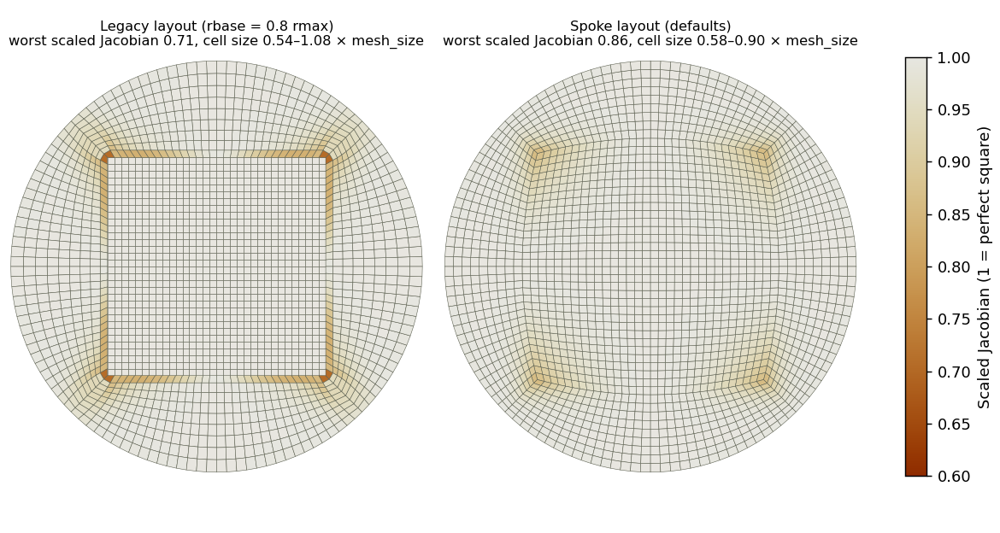

# ModularHexMesh

Small, dependency-free generators for structured HEX8 (hexahedral) meshes:

- `cylindricalMesh.py` builds a cylinder as an O-grid: a square core plus rings that blend into the circle, extruded along an axis.
- `cuboidMesh.py` builds a box of hexahedra.

Both write VTK 3.0 ASCII files (`DATASET UNSTRUCTURED_GRID`, cell type 12), readable by ParaView, meshio, PyVista and most finite-element tools.



*Default cylinder cross-section (20 cells across the radius), per cell: scaled Jacobian, aspect ratio, and size relative to the mean cell size. The least square cells sit at the four core corners, the most stretched on the rim along the diagonals (see [Tuning](#tuning)).*

## Requirements

Python 3.11 or newer (uses `tomllib`). On older Python, `pip install tomli`. No other packages are needed.

## Usage

```bash
python cylindricalMesh.py --config cylindricalMesh.example.toml
python cuboidMesh.py      --config cuboidMesh.example.toml
```

`--config` is the only argument. Relative output paths are resolved from the
directory of the config file, not from the current directory.

The cylinder script prints a summary, including a quality report of the cross-section:

```
  quality (cross-section):
    scaled Jacobian : min 0.865  mean 0.988  (1 = square)
    aspect ratio max: 1.767
    mean cell size  : 0.800 x target (1.5)
    size uniformity : min 0.757  max 1.229 x mean  CV 0.086
```

- **scaled Jacobian:** the sine of the worst corner angle of a cell. 1 is a perfect square, values at or below 0 are inverted cells.
- **aspect ratio:** longest over shortest edge of a cell.
- **mean cell size:** cell size is the square root of the cell area; this line gives the mean over all cells divided by the target size (`mesh_size`).
- **size uniformity:** smallest and largest cell size divided by the mean cell size, and the coefficient of variation (standard deviation over the mean). All three are 1, 1 and 0 for a perfectly uniform mesh, whatever the target size.

Extrusion along the axis does not change these in-plane numbers.

### Units

No unit is enforced: all lengths are in whatever unit your application uses.
If the mesh is used in single-precision code, choose the unit so element sizes
are of order 1.

## Cylinder input (`cylindricalMesh.py`)

All keys go in a `[mesh]` table; `[fields]` is optional. Where a key has
aliases, the first one present in the list is used.

### Geometry and resolution

| Key (aliases) | Default | Meaning |
|---|---|---|
| `rmax` (`outer_radius`) | required | Cylinder radius. |
| `length` (`z_length`) | required | Length along the axis. |
| `mesh_size` (`elem_size`, `element_size`, `target_mesh_size`) | - | Target edge length. Sets the angular resolution, the radial layers and (in `mesh_size` axial mode) the axial step. |
| `h` (`angular_resolution`) | from `mesh_size` | Overrides the angular resolution: `ntheta = 8 h` nodes around the circle, `2 h` cells per side of the core. Give `h` or `mesh_size`; with only `h`, the rim cell width is used as the target size. |
| `length_axis` (`axis`, `cylinder_axis`) | `"z"` | Cylinder axis: `x`, `y` or `z`. |
| `axis_start` (`z_start`, `z0`, `start`) | `length/2` | Axial position of the first node layer. Layers run towards negative values, so the default centres the mesh on 0. |
| `shift` (`origin_shift`, `offset`) | `[0, 0, 0]` | Translation applied to all points. |

### Cross-section

| Key (aliases) | Default | Meaning |
|---|---|---|
| `core_fraction` | `0.55` | Core half-width divided by `rmax`. Must satisfy `core_fraction * max(sqrt(2), 1 + core_bulge) < 1`. |
| `core_bulge` | `0.134` | Outward bow of each core edge at mid-side, as a fraction of the half-width. The default, tan(15 deg)/2, makes the core corners 120 deg. |
| `nr` (`n_radial`) | from the target size | Number of rings minus one, so the annulus has `nr + 1` cell layers. |

These defaults are optimal at every resolution (see [Tuning](#tuning)), so in
normal use only `rmax`, `length` and `mesh_size` need to be set.

### Axial discretization

| Key (aliases) | Meaning |
|---|---|
| `axial_mode` (`z_mode`) | `mesh_size` (default): `round(length / target size)` layers. `fixed_layers`: needs `n_layers` (`layers`, `nz`). `fixed_dz`: needs `dz` (`axial_step`), rounded so the layers fill `length`. |

### Output

| Key (aliases) | Default | Meaning |
|---|---|---|
| `output_folder` (`output_dir`, `outdir`) | `.` | Output directory. |
| `output_filename` (`filename`, `outfile_name`) | `cylinder.vtk` | Output file name. |
| `output` (`outfile`, `output_file`) | - | Full output path; use either this or the folder/filename pair. |
| `append_hmax` (`append_max_elem_size`) | `true` | Appends `_hmax<value>` to the file name; hmax is the largest edge in the cross-section or the axial step. |

### Point fields (`[fields]`)

| Key (aliases) | Default | Meaning |
|---|---|---|
| `write` (`write_fields`) | `true` | Write `RefractiveIndex` and `Absorptivity` as point data. Set `false` to write the mesh only. |
| `n1`, `n2` | 1.4, 1.0 | Refractive index on the axis and the lower clamp. |
| `amax` (`alpha_max`), `amin` (`alpha_min`) | 0.5, 0.02 | Absorptivity on the axis and the lower clamp. |
| `profile_radius` (`radius`) | 1.0 | Radius $R$ of the profile. |

Both fields follow the parabolic (GRIN-lens-like) test profile
$v(r) = \sqrt{v_{high}^2 (1 - 2 \Delta (r/R)^2)}$ with $\Delta = \frac{1}{2}(1 - (v_{low}/v_{high})^2)$, clamped below at $v_{low}$, where $r$ is the distance from the axis.

### Example

```toml
[mesh]
output_folder = "./output"
output_filename = "cylinder.vtk"
rmax = 150.0
length = 300.0
mesh_size = 1.5

[fields]
write = false
```

## Cuboid input (`cuboidMesh.py`)

| Key (aliases) | Default | Meaning |
|---|---|---|
| `sidelength` (`side_length`, `size`) | required | `[lx, ly, lz]`. |
| `nelems` (`n_elems`, `nElements`) | - | Cells per axis, `[nx, ny, nz]`. |
| `elemsize` (`elem_size`, `element_size`) | - | Cell size per axis; must divide `sidelength` exactly. Give exactly one of `nelems` and `elemsize`. |
| `center` (`center_at_origin`, `centered`) | `true` | Box spans `[-L/2, L/2]`; `false` starts at 0. |
| `shift` (`origin_shift`, `offset`) | `[0, 0, 0]` | Translation after centring. |
| `output_folder`, `output_filename`, `output` | `.`, `cuboid_hex8.vtk` | As for the cylinder. `_hmax<value>` is always appended. |

Nodes are numbered with x fastest; cells use the standard VTK hexahedron node order. No point data is written.

## How the cylinder mesh is built

### Topology

The cross-section is an O-grid. A square core of $n \times n$ cells is
surrounded by an annulus of $n_r + 1$ cell layers with $n_\theta = 4n$ cells
around. The 2D quads are then extruded into hexahedra along the axis. The node
order of each hexahedron is checked once so all cells have a positive volume.

The angular resolution follows from the target size $h$ (`mesh_size`):
$n_\theta = 8 \cdot \mathrm{round}(2 \pi R / (8 h))$, so the cells on the rim are about $h$ wide. Because the
core shares its boundary nodes with the annulus, the core always has $n = n_\theta / 4$ cells per side.

### Core

Core nodes sit on a uniform $(u, v)$ grid on $[-1, 1]^2$, mapped as

$$x = u s (1 + b (1 - v^2)), \qquad y = v s (1 + b (1 - u^2)) \qquad (1)$$

with half-width $s = c R$ (`core_fraction` $c$) and bulge $b$ (`core_bulge`).
With $b = 0$ this is a plain square grid. With $b > 0$ each edge bows outward by $b s$ at mid-side.

### Rings

Node $j$ of the core boundary, $B_j$, is joined by a straight spoke to node $j$
on the circle, $O_j = R(\cos \theta_j, \sin \theta_j)$ with $\theta_j = 2 \pi j / n_\theta$. Ring $k$ (for $k = 0 \dots n_r$) is

$$P_{k j} = B_j + t_k (O_j - B_j), \qquad t_k = \frac{k + 1}{n_r + 1} \qquad (2)$$

so the inner rings follow the node spacing of the core (there is no skewed
transition layer) and the outermost ring is the circle. The number of rings is
chosen so the radial step along the longest spoke (at mid-side) is close to the target:
$n_r = \mathrm{round}((R - s(1 + b)) / h)$.

### Tuning

The two free parameters, $b$ and $c$, are set from closed-form arguments. The
optimum does not depend on resolution, so no search is done at run time.

**Bulge.** With equation (1), each core edge leaves the corner tilted outward
by $\arctan(2b)$, so the core corner angle is $90^\circ + 2 \arctan(2b)$ and each
of the two ring cells at that corner gets $135^\circ - \arctan(2b)$. These three
cells meeting at a node limit the quality of any 4-corner O-grid. The scaled
Jacobian of a corner is the sine of its angle, so the best choice is three
equal $120^\circ$ angles:

$$b^* = \frac{1}{2} \tan(15^\circ) \approx 0.134, \qquad \mathrm{SJ}_{min} = \sin(120^\circ) \approx 0.866 \qquad (3)$$

Without bulge the worst cells have $135^\circ$ corners ($\mathrm{SJ} = 0.707$).

**Core size.** With $n = n_\theta / 4$ fixed, the core cells are smaller than
the rim cells by a factor $4c/\pi$; making them equal would need $c = \pi/4$,
which puts the core corners outside the cylinder. The core size therefore
trades two kinds of stretched cells against each other:

- cells just outside the core at mid-side are one core cell wide and about $h$ long, an aspect ratio of $\pi / (4c)$, which falls as the core grows;
- rim cells on the diagonals are $h$ wide but radially squeezed, because every spoke has the same number of layers and the diagonal spoke is the shortest: aspect ratio $(1 - c(1 + b)) / (1 - \sqrt{2} c)$, which rises as the core grows.

Equating the two gives the least stretched mesh,

$$\frac{\pi}{4 c} = \frac{1 - c (1 + b)}{1 - \sqrt{2} c} \qquad (4)$$

which at $b^*$ gives $c \approx 0.51$. The smallest ratio of largest to smallest
cell is at $c \approx 0.49$ (maximum of $c(1 - \sqrt{2} c) / (1 - c(1 + b))$, the
squared size of the smallest cell), and the lowest overall size variation is at
$c \approx 0.58$ (found numerically). The default $c = 0.55$ is within about 15 % of
the best on all three at once.

Grading the radial layers along the diagonal spokes, and Laplacian smoothing of
the nodes, were both tested and made the mesh worse, so neither is used.

### Resulting quality

Per-cell quality of the default cross-section under refinement ($R = 150$,
`mesh_size` = $R$ / cells across the radius). "Central 95 %" is the range that
covers 95 % of the cells (2.5th to 97.5th percentile); cell size is the square
root of the cell area, given relative to the mean cell size.

| Cells across radius | Cells per layer | Mean size / mesh_size | Size vs mean, central 95 % | Size vs mean, min / max | Worst scaled Jacobian | Best scaled Jacobian | Aspect min | Aspect mean | Aspect central 95 % | Aspect max |
|---|---|---|---|---|---|---|---|---|---|---|
| 10 | 576 | 0.74 | -19 % / +14 % | -23 % / +15 % | 0.858 | 1.000 | 1.00 | 1.26 | 1.01 - 2.05 | 2.21 |
| 20 | 2,176 | 0.76 | -17 % / +16 % | -24 % / +19 % | 0.862 | 1.000 | 1.00 | 1.16 | 1.01 - 1.72 | 1.99 |
| 40 | 7,812 | 0.80 | -15 % / +18 % | -24 % / +22 % | 0.864 | 1.000 | 1.00 | 1.12 | 1.00 - 1.53 | 1.82 |
| 80 | 31,500 | 0.80 | -14 % / +20 % | -24 % / +23 % | 0.865 | 1.000 | 1.00 | 1.11 | 1.00 - 1.44 | 1.74 |
| 160 | 124,992 | 0.80 | -14 % / +20 % | -24 % / +24 % | 0.866 | 1.000 | 1.00 | 1.11 | 1.00 - 1.41 | 1.71 |

The quality improves slightly and then converges under refinement: the worst scaled Jacobian
approaches the limit $\sin(120^\circ) = 0.866$ of equation (3), and the largest
aspect ratio drops towards 1.7 as the spokes are resolved more finely. 95 % of
the cells stay within about $\pm 20$ % of the mean size at every resolution.
The mean cell size settles at 0.80 times `mesh_size`, because the angular
resolution is set so the rim cells (the largest) are about `mesh_size` wide.
